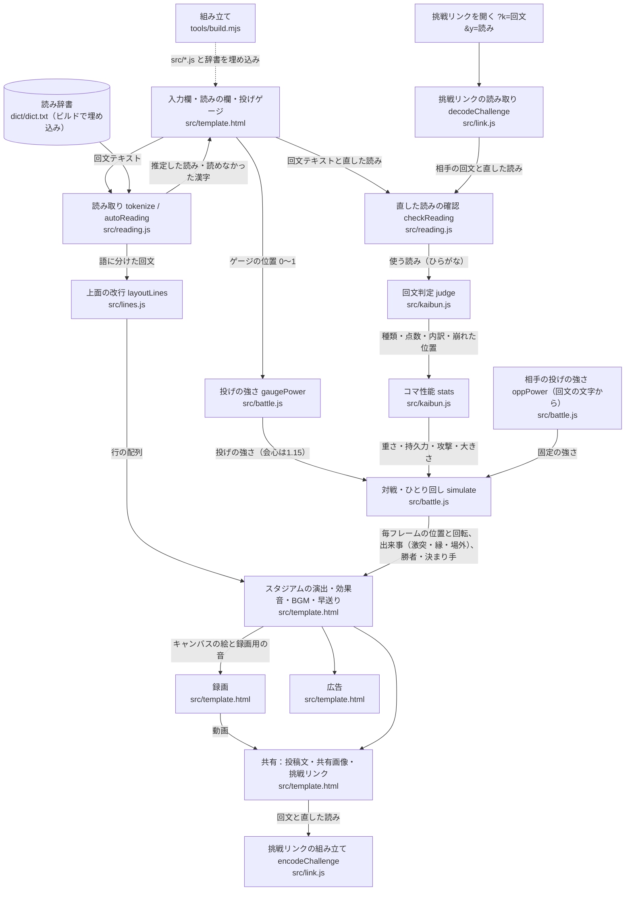

# 回文ケンカゴマ：処理フロー

回文を入力すると、その文がコマの上面に横書きで並んで回る。挑戦リンク（`?k=回文`）から開くと、相手の回文コマと自分の回文コマがスタジアムでぶつかり合い、勝敗がつく。
静的HTML1枚で動き、サーバーもAPIも使わない。公開先は https://sakuichi.github.io/kaibun-koma/ （予定）。

## 箱どうしで受け渡すデータ

各 `src/*.js` は布団飛ばしの `src/engine.js` と同じ形にする：即時関数でオブジェクトを作り、ブラウザでは全体の定数として、Nodeでは `module.exports` として使う（`if (typeof module !== 'undefined') module.exports = …;`）。

### 読み取り `src/reading.js`（`RD`）

| 関数 | 入力 | 出力 |
|---|---|---|
| `setDict(text)` | 辞書の中身（布団飛ばしの `dict/dict.txt` と同じ形式。1行に「表記 TAB 読み」、名詞は読みの先頭に `.`、人名は `!`） | なし |
| `tokenize(text)` | 回文テキスト | `{ toks: [{ surface, reading（カタカナ）, kind: 'word' \| 'kana' \| 'gap' }], unknown: [読めなかった漢字] }`（布団飛ばしと同じ） |
| `autoReading(text)` | 回文テキスト | `{ yomi: 推定した読み（ひらがな。記号と読めない文字は含まない）, unknown: [読めなかった文字（辞書にない漢字・英字・まれな漢字）] }` |
| `checkReading(text, yomi)` | 回文テキストと、直した読み（ひらがな・カタカナどちらでも。空白は無視） | `{ ok, yomi: ひらがなにそろえた読み, reason: null \| 'kana' \| 'empty' \| 'long' }` |
| `toHira(s)` | 文字列 | カタカナをひらがなにした文字列 |

- `checkReading` の決まり：かなの部分（ひらがな・カタカナ・長音）はそのまま残っていること。漢字・数字・英字のかたまりは、それぞれ1文字以上の読みに置き換わっていて、読みの長さが漢字1文字につき6かな、英字・数字1文字につき4かなを超えないこと。記号と空白は無視する。かなの部分が変わっていれば `reason: 'kana'`、読みが空のかたまりがあれば `reason: 'empty'`、読みが長すぎれば `reason: 'long'` で `ok: false`（表示と無関係な読みを入れて強いコマを作るズルの防止）。照合は正規表現の後戻りに頼らず、かたまりを前から順に表で当てはめる（細工した長い読みでも時間が増えすぎない）

### 回文判定とコマ性能 `src/kaibun.js`（`KB`）

| 関数 | 入力 | 出力 |
|---|---|---|
| `judge(yomi, text)` | 読み（ひらがな・カタカナ）、回文テキスト（文章らしさの点に使う。省略可） | `{ kind, kana, loose, n, uniq, bad, score, parts }` |
| `stats(j)` | `judge` の結果 | `{ weight, endurance, attack, radius }` |

- `kind`：`'成立'`（読みが1文字ずつ完全に一致）、`'ゆるめ'`（濁点・半濁点・小書き文字・長音の違いを許せば一致）、`'手抜き'`（一致するが、音の種類が1つだけ、または種類÷音の数が0.34未満。「とまと」「きつつき」のような短い回文は手抜きにしない）、`'不成立'`、`'短すぎ'`（長音を除いて3音未満）
- `kana`：読みをひらがな1文字ずつにした配列（長音を含む）。`loose`：比べるためにゆるめた配列（濁点などを外し、長音を除く）。`n`：長音を除いた音の数。`uniq`：`loose` の音の種類の数
- `bad`：不成立のとき、`loose` で最初に食い違う位置（前から数えた番号）。それ以外は -1
- `score`：0〜100 の整数。`parts`：`{ len, strict, variety, words }`（長さ・厳密さ・音の多様さ・漢字や語の含有。各0〜25、合計が `score`）。不成立と短すぎは0点
- `stats`：重さ `weight` は長さで増え、伸びは頭打ち（0.8〜3）。持久力 `endurance` は 成立1・ゆるめ0.75・手抜き0.35・不成立0.35・短すぎ0.3。攻撃 `attack` は音の種類で増え、頭打ち（手抜きは0.35倍。会心で投げてもほぼ勝てない強さ）。大きさ `radius` は全員同じ（0.13）。同じ入力なら必ず同じ値

### 上面の改行 `src/lines.js`（`LN`）

| 関数 | 入力 | 出力 |
|---|---|---|
| `layoutLines(toks)` | `RD.tokenize(text).toks` | 行の配列（文字列） |

- 1行の文字数の目安は `max(3, ceil(√文字数 × 1.15))`（文字のかたまりが丸っぽくなる）
- 語の途中では切らない。語が目安より長いときだけ文字で切る
- 行頭に小さい字・長音・句読点が来たら、前の行の末尾へ送る
- 全行をつなぐと、元の文（空白を除く）と一致する

### 対戦計算 `src/battle.js`（`BT`）

| 関数・定数 | 入力 | 出力 |
|---|---|---|
| `gaugePower(x)` | ゲージの位置 0〜1 | 投げの強さ。真ん中ほど強い。真ん中から0.035以内は会心で `CRIT_POWER`（1.15）。端は最小の0.1。左右対称 |
| `oppPower(s)` | 相手の回文テキスト（画面からは文字を渡す。リンクを作る側が読みを変えて強さを狙えないように） | 相手の投げの強さ（0.45〜0.85、小数2桁）。同じ文字列なら必ず同じ値 |
| `simulate(specs, seed)` | `specs`：`[{ stats, power }]`（1つならひとり回し、2つなら対戦）、`seed`：乱数の種（整数） | `{ frames, hits, rims, winner, kimarite, decideFrame }` |
| `DT` `TMAX` `SOLO_MAX` `CRIT_POWER` | | 1フレームの秒数（1/60）、対戦の制限時間（30秒）、ひとり回しの上限（90秒）、会心の強さ（1.15） |

- `frames[i][k]`：i フレーム目の k 番目のコマ。`[x, y, 回転, 角度, 傾き, 傾きの向き, 状態, 高さ]`。状態は 0 回転中・1 場外・2 停止
- `hits`：コマどうしの激突 `{ f: フレーム, x, y, p: 強さ0〜1 }`。`rims`：縁に当たった `{ f, x, y, p, k: どのコマか }`
- `winner`：対戦では 0（自分）・1（相手）・-1（相打ち）。ひとり回しでは `null`
- `kimarite`：`'場外'` `'先に止まる'` `'時間切れ'` `'相打ち'`。ひとり回しでは `null`
- `decideFrame`：決着した（ひとり回しは止まった）フレーム。そのあと約2.4秒ぶんフレームが続く（勝者が回り続ける演出用）
- 同じ `specs` と `seed` なら、出力は完全に同じ。対戦は必ず `TMAX` 秒以内に決着する

### 挑戦リンク `src/link.js`（`LK`）

| 関数 | 入力 | 出力 |
|---|---|---|
| `encodeChallenge(text, yomi)` | 回文テキスト、読み（画面からは直したかどうかにかかわらず常に渡す） | `?k=…&y=…`（読みを省略したときは `?k=…` だけ） |
| `decodeChallenge(search)` | `location.search` の文字列 | `{ text, yomi }`（`y` がなければ `yomi: null`）。`k` がない・空・`MAX_LEN`（60文字）を超えるときは `null` |

- `k` と `y` 以外の値（点数など）は無視する。強さは開いた側で計算し直す
- 読みの正しさは `decodeChallenge` では確かめない。受け取った側が `checkReading` で確かめ、だめなら辞書で推定した読みを使う

### 画面 `src/template.html`

上記すべてを受け取り、入力・読みの修正・投げゲージ・スタジアムの演出（対戦カード、掛け声「レディー… → ファイト!!／ゴー!!」、激突の演出、早送り）・効果音・BGM・録画・共有・広告を受け持つ。

## 決めごと

- 挑戦リンクに入れるのは回文の文字と読みだけ（読みは常に入れる。辞書が変わっても送った側の意図どおりの回文で受け取れるように）。強さは開いた側で計算し直す（点数を書き換えるズルを防ぐ）
- 相手の投げの強さは、回文の文字から決まる固定値
- 回せるのは、読めない文字が残っておらず、成立・ゆるめ・手抜きのときだけ（自分も挑戦状の相手も同じ）
- 外部通信はGoogle Fontsだけ。入力した文はどこにも送らない
- 広告：Amazonアソシエイト（トラッキングIDは布団飛ばしと共通）。結果に合わせたギャグの商品を出す（ひとり回しは回文の点数、対戦は勝敗と決まり手で選ぶ。手抜きの回文は専用）
- 録画：いたずラッシュと同じ形式（録画用キャンバス＋録画用の音 → MediaRecorder。最初はオン、切り替えはブラウザに記憶）。早送りした部分は動画でも早送りになる
- 効果音とBGM：ブラウザ組み込みの音声合成で作る（音のファイルは使わない）。消音にしても動画には音が入る
- BGM：3曲（ユーロビート調210・ドラムンベース調230・ロック調225）から毎回ランダム。ゲージ中は「ビルドアップ」のループ（スネアがだんだん細かくなり、音が上がっていく「ため」。BPM220）、投げてから決着までバトル曲を流し、決着で下げて勝ち負けの音につなぐ。早送りしてもテンポは変えない。タブを裏に回したら音ごと止め、表に戻ったら続きから鳴らす
- `prefers-reduced-motion` のときは、揺れ・光・スロー・寄りを省く

## 対戦計算の調整でわかったこと

調整値は `src/battle.js` のコメントにある（Nodeで多数回まわして合わせた）。

- 引力が中心からの距離に比例するだけだと、どの半径でも1周の時間が同じになり、2つのコマが永遠に出会わない（一定の引力を足している）
- 回転の減りが左右同じだと、投げの強さだけで勝敗が決まる（激突で相手の攻撃×回転÷自分の重さだけ回転が減り、当たりの良し悪しに種つき乱数を入れている）
- 首を振り始めたコマを飛ばされやすくすると、終盤に場外が起きる
- 縁で跳ね返す（外向きの勢いが強いときだけ場外）と、激しい初撃でも即場外になりにくい
- 長さ・音の種類の効きは頭打ちにしないと、長い回文が強すぎる
- 会心の一撃（最初の激突の攻撃増し＋相手の回転を奪う）で逆転の目が出る。ただし手抜きの回文は、会心でもほぼ勝てないところまで性能を下げている
